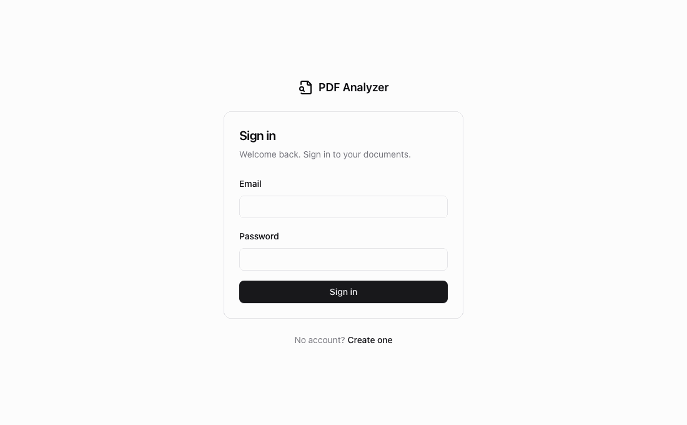

# PDF Analyzer

[](https://github.com/chlosaw/pdf-analyzer/actions/workflows/ci.yml)

Chat with your PDFs: upload documents, ask questions, and get answers that stream in with page citations you can click to jump to the source.

**Live demo:** not deployed yet. The [Render blueprint](render.yaml) is ready; see [Deploying](#deploying).
**Demo login:** `demo@pdf-analyzer.dev` / `demo1234`. The account comes with two sample PDFs: a company annual report and an employee handbook. Locally it is created by `docker compose up`.



## Features

- **RAG pipeline written from scratch, no LangChain.** PDF → page text → chunks → Gemini embeddings → PostgreSQL + pgvector → similarity search → a grounded answer.
- **Page citations.** `[1]` markers in the answer become clickable `p.3` chips. Clicking one opens that page in the PDF viewer and highlights the cited text.
- **Streaming answers** over Server-Sent Events, with a Stop button. A partial answer is kept.
- **Multi-document chat.** Select up to 10 PDFs and ask across all of them; each source shows which document it came from.
- **Chat history saved per document**, plus saved multi-document chats.
- **Limits and errors.** A 15 MB cap checked on both client and server, a `%PDF-` signature check, scanned-PDF detection ("No text found"), clear errors for password-protected and corrupt files, and rate limits on sign-ins, uploads and questions.
- **Accounts.** JWT in an httpOnly cookie, bcrypt password hashes, and every query scoped to the signed-in user.
- **Runs offline.** With `AI_PROVIDER=fake` the app needs no API key. It uses deterministic embeddings and extractive answers, the same mode the tests run in.

## Tech stack

| Layer    | Tools                                                                      |
| -------- | -------------------------------------------------------------------------- |
| Frontend | React 18, TypeScript, Vite, React Router, TanStack Query, react-pdf        |
| UI       | Tailwind CSS, shadcn/ui, lucide icons, react-markdown                      |
| Backend  | Node.js, Express 5, TypeScript, Zod, Multer, pdf.js                        |
| Database | PostgreSQL + Prisma, pgvector for embeddings                               |
| AI       | Google Gemini: `gemini-embedding-001` (768-d) and `gemini-2.5-flash`       |
| Shared   | `packages/shared`: Zod schemas, API types and limits used by both apps     |
| Auth     | JWT in httpOnly cookies + bcrypt                                           |
| Tests    | Vitest + Supertest (API), Playwright (end-to-end)                          |
| DevOps   | npm workspaces, ESLint, Prettier, Docker, docker compose, GitHub Actions   |
| Hosting  | Render (web + api), Neon (Postgres with pgvector), Supabase Storage (PDFs) |

## Architecture


When a PDF is uploaded, the API extracts its text page by page with pdf.js, rejects scans that have no text, stores the file and returns right away. A background job then splits each page into overlapping chunks, embeds them with Gemini and writes the vectors to pgvector. Because a chunk never crosses a page, every chunk has exactly one page number. To answer a question, the API embeds it and pulls the nearest chunks from the chat's documents (cosine distance, `<=>`). It sends them to the model as numbered sources, streams the reply over SSE and saves the answer with the pages it cited. In Docker, nginx serves the React build and proxies `/api` to Express, so the auth cookie stays same-origin.

```
apps/api/src/
  modules/  auth/  documents/  chat/  embeddings/   (routes → controllers → services)
  jobs/     ingestDocument.ts                       (chunk → embed → store, off the request path)
  middleware/  lib/
apps/web/src/
  api/  components/  features/{auth,documents,chat,viewer}/  pages/  lib/
packages/shared/                                    (Zod schemas + types)
```

## Run locally

Requires Docker.

```bash
cp .env.example .env
docker compose up --build
```

Open http://localhost:8080 and sign in with the demo account. This runs the web app, the API and Postgres with pgvector. The default `AI_PROVIDER=fake` works with no API key. For real answers, set `AI_PROVIDER=gemini` and `GEMINI_API_KEY` in `.env` ([get a free key](https://aistudio.google.com/apikey)), then re-upload your documents, because the two providers' embeddings aren't comparable.

**Without Docker** (hot reload; needs Node 20.16+ and Postgres with pgvector, e.g. `brew install postgresql@17 pgvector`):

```bash
cp .env.example .env    # point DATABASE_URL at your Postgres
npm install
npm run db:migrate && npm run db:seed
npm run dev             # web http://localhost:5173, api http://localhost:4000
```

## Tests

```bash
npm run lint && npm run format:check && npm run typecheck

# Unit + API tests. Needs an empty database (it is wiped): TEST_DATABASE_URL in .env
createdb pdf_analyzer_test
npm test

# End-to-end (production builds of both apps, offline AI). Needs E2E_DATABASE_URL.
createdb pdf_analyzer_e2e
npx playwright install chromium
npm run build && npm run test:e2e
```

- **API (Supertest):** auth (cookie flags, validation, duplicates, forged tokens, rate limit), uploads (chunked and embedded per page; a scanned PDF → 422, a non-PDF → 415, an oversized file → 413; upload rate limit), other users' data → 404, the streamed answer cites the right page, multi-document retrieval, history.
- **Unit:** chunker edge cases, the SSE parser (frames split across network chunks), the shared schemas.
- **E2E (Playwright):** register → upload → wait for indexing → ask → click the citation → the viewer is on page 2 → reload and the history is still there; a scanned PDF shows "No text found".

GitHub Actions runs all of the above on every push and pull request, against a pgvector service container, and also builds both Docker images.

## Deploying

1. **Neon:** create a database and copy the direct (non-pooled) connection string. The first migration enables pgvector.
2. **Supabase:** create a private Storage bucket named `pdfs`, and copy the project URL and the `service_role` key.
3. **Render:** New → Blueprint → this repo. Fill in `DATABASE_URL`, `GEMINI_API_KEY` and the Supabase values on `pdf-analyzer-api`, then set `API_UPSTREAM` on `pdf-analyzer-web` to the API's URL. Migrations run and the demo account is seeded on each start.

## What I'd improve next

- **OCR for scanned PDFs** (Tesseract, or Gemini's vision input) instead of rejecting them.
- **Better retrieval:** rewrite follow-up questions ("what about the second one?") into standalone queries, and combine pgvector with Postgres full-text search (hybrid search).
- **A real job queue** (pg-boss on the same Postgres) instead of in-process background work, with retries and per-document indexing progress.
