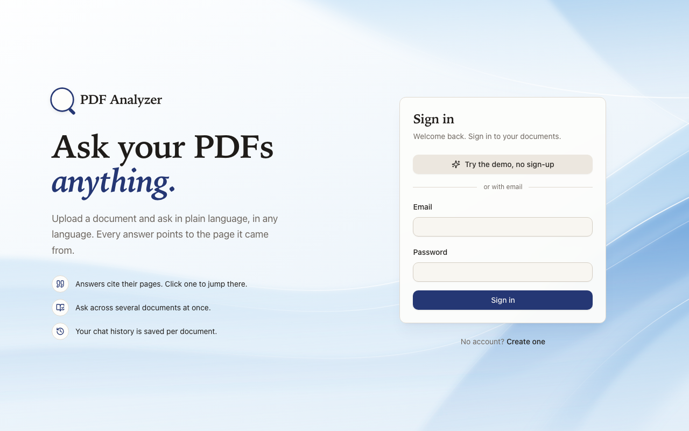
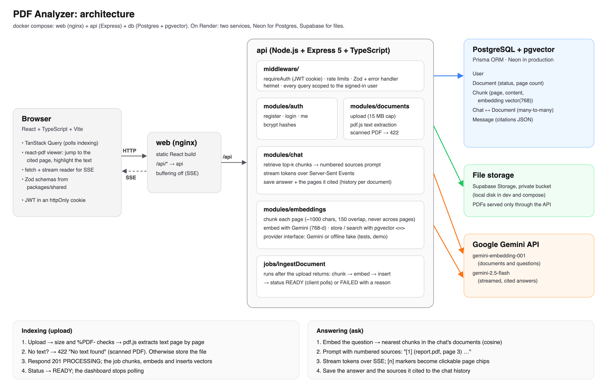

# PDF Analyzer

[](https://github.com/chlosaw/pdf-analyzer/actions/workflows/ci.yml)

Chat with your PDFs: upload documents, ask questions, and get answers that stream in with page citations you can click to jump to the source.

**Live demo:** not deployed yet. The [Render blueprint](render.yaml) is ready; see [Deploying](#deploying).
**Demo login:** no account needed. Click **Try the demo, no sign-up** on the sign-in page to get a private sandbox with two indexed sample PDFs (a company annual report and an employee handbook). It is deleted after 24 hours. There is also a shared account, `demo@pdf-analyzer.dev` / `demo1234`, which `docker compose up` creates locally.


## Features

- **RAG pipeline written from scratch, no LangChain.** PDF → page text → chunks → Gemini embeddings → PostgreSQL + pgvector → similarity search → a grounded answer.
- **Page citations.** `[1]` markers in the answer become clickable `p.3` chips. Clicking one opens that page in the PDF viewer and highlights the cited text.
- **Streaming answers** over Server-Sent Events, with a Stop button. A partial answer is kept.
- **Multi-document chat and saved history.** Select up to 10 PDFs and ask across all of them. Each document keeps its own chat history, and multi-document chats are saved too.
- **Search, filters and paging.** Documents can be searched by name (debounced as you type), filtered by status, sorted and paged, and renamed inline. Renames and deletes show up at once and roll back if the server refuses.
- **Admin role.** Administrators get a page with usage totals and user management: search, role changes and account deletion. The API enforces the role on every request.
- **Documented API.** An OpenAPI 3.1 spec, generated from the same Zod schemas the API validates with, browsable at `/api/docs`.
- **Limits and errors.** A 15 MB cap checked on both client and server, a `%PDF-` signature check, scanned-PDF detection ("No text found"), and clear errors for password-protected and corrupt files.
- **Security built against the OWASP Top 10.** Rate limits and account lockout, revocable server-side sessions in httpOnly cookies, bcrypt, CSRF origin checks, a strict Content-Security-Policy, parameterised SQL only (enforced by lint), prompt-injection defences, security event logging, and dependency, secret and CodeQL scanning in CI. [SECURITY.md](SECURITY.md) maps each risk to its controls and tests.
- **Designed for the Mac.** Headings in New York, text in SF Pro and numbers in SF Mono, with light and dark themes. Pages sit on flowing blue silk waves, drawn as SVG (deep navy in dark mode), which sway gently and hold still for people who prefer reduced motion. Other systems fall back to their own fonts.
- **Demo sandboxes.** Visitors try the app without signing up. Each gets a private account with the sample PDFs already indexed, and an hourly job deletes it, along with its stored files, after 24 hours.
- **Runs offline.** With `AI_PROVIDER=fake` the app needs no API key: it uses deterministic embeddings and extractive answers, the same mode the tests run in.



## Tech stack

| Layer    | Tools                                                                      |
| -------- | -------------------------------------------------------------------------- |
| Frontend | React 18, TypeScript, Vite, React Router, TanStack Query, react-pdf        |
| UI       | Tailwind CSS, shadcn/ui, lucide icons, react-markdown                      |
| Backend  | Node.js, Express 5, TypeScript, Zod, Multer, pdf.js                        |
| Database | PostgreSQL + Prisma, pgvector for embeddings                               |
| AI       | Google Gemini: `gemini-embedding-001` (768-d) and `gemini-3.8-flash`       |
| Shared   | `packages/shared`: Zod schemas, API types and limits used by both apps     |
| Auth     | JWT in httpOnly cookies backed by server-side sessions, bcrypt, roles      |
| API docs | OpenAPI 3.1 generated from Zod, Swagger UI                                 |
| Tests    | Vitest + Supertest (API), Testing Library (components), Playwright + axe   |
| DevOps   | npm workspaces, ESLint, Prettier, Docker, docker compose, GitHub Actions   |
| Hosting  | Render (web + api), Neon (Postgres with pgvector), Supabase Storage (PDFs) |

## Architecture



When a PDF is uploaded, the API extracts its text page by page with pdf.js, rejects scans that have no text, stores the file and returns right away. A background job then splits each page into overlapping chunks, embeds them with Gemini and writes the vectors to pgvector. Because a chunk never crosses a page, every chunk has exactly one page number. To answer a question, the API embeds it and pulls the nearest chunks from the chat's documents (cosine distance, `<=>`). It sends them to the model as numbered sources, streams the reply over SSE and saves the answer with the pages it cited. Demo sandboxes are ordinary accounts flagged `isDemo`; a second in-process job removes them after a day. In Docker, nginx serves the React build and proxies `/api` to Express, so the auth cookie stays same-origin.

```
apps/api/src/
  modules/  auth/  documents/  chat/  embeddings/  demo/  admin/   (routes → controllers → services)
  docs/     openapi.ts                              (OpenAPI spec, served at /api/docs)
  jobs/     ingestDocument.ts                       (chunk → embed → store, off the request path)
            cleanupDemoSandboxes.ts                 (hourly: delete demo sandboxes older than 24 h)
  middleware/  lib/
apps/web/src/
  api/  components/  features/{auth,documents,chat,viewer}/  pages/  lib/  test/
packages/shared/                                    (Zod schemas + types)
```

## Run locally

Requires Docker.

```bash
cp .env.example .env
docker compose up --build
```

Open http://localhost:8080 and sign in with the demo account. The API docs are at http://localhost:8080/api/docs. To try the admin page, set `ADMIN_EMAIL` and `ADMIN_PASSWORD` in `.env` before starting (or promote any account with `npm run make-admin -w apps/api -- you@example.com`). This runs the web app, the API and Postgres with pgvector. The default `AI_PROVIDER=fake` works with no API key. For real answers, set `AI_PROVIDER=gemini` and `GEMINI_API_KEY` in `.env` ([get a free key](https://aistudio.google.com/apikey)), then re-upload your documents, because the two providers' embeddings aren't comparable.

**Without Docker** (hot reload; needs Node 20.16+ and Postgres with pgvector, e.g. `brew install postgresql@17 pgvector`):

```bash
cp .env.example .env    # point DATABASE_URL at your Postgres
npm install
npm run db:migrate && npm run db:seed
npm run dev             # web http://localhost:5173, api http://localhost:4000
```

## API

Interactive docs: **`/api/docs`** (Swagger UI), and the raw spec at `/api/openapi.json`. Tests check that every route in the code is documented, and every documented route exists.

| Method                 | Path                      | What it does                                                                   |
| ---------------------- | ------------------------- | ------------------------------------------------------------------------------ |
| `POST`                 | `/api/auth/register`      | Create an account and sign in (sets the httpOnly `token` cookie)               |
| `POST`                 | `/api/auth/login`         | Sign in                                                                        |
| `POST`                 | `/api/auth/demo`          | Start a throwaway demo sandbox                                                 |
| `POST`                 | `/api/auth/logout`        | Sign out and revoke the session                                                |
| `GET`                  | `/api/auth/me`            | The signed-in user                                                             |
| `GET`                  | `/api/documents`          | List: `?q=&status=&sort=newest\|oldest\|name\|size&page=&pageSize=`            |
| `POST`                 | `/api/documents`          | Upload a PDF (multipart `file`)                                                |
| `GET` `PATCH` `DELETE` | `/api/documents/:id`      | Get, rename, delete                                                            |
| `GET`                  | `/api/documents/:id/file` | The original PDF                                                               |
| `POST`                 | `/api/documents/:id/chat` | Get or create the document's own chat                                          |
| `GET` `POST`           | `/api/chats`              | List (`?q=&kind=document\|multi&page=&pageSize=`); start a multi-document chat |
| `GET` `PATCH` `DELETE` | `/api/chats/:id`          | Get with messages, rename, delete                                              |
| `POST`                 | `/api/chats/:id/messages` | Ask a question; the answer streams back as Server-Sent Events                  |
| `DELETE`               | `/api/chats/:id/messages` | Clear the history                                                              |
| `GET`                  | `/api/admin/stats`        | Usage totals (admins only)                                                     |
| `GET`                  | `/api/admin/users`        | List users: `?q=&role=&includeDemo=&page=&pageSize=` (admins only)             |
| `PATCH` `DELETE`       | `/api/admin/users/:id`    | Change role, delete with all their data (admins only)                          |
| `GET`                  | `/api/health`             | Liveness and database check                                                    |

Conventions: JSON in and out, and Zod validation with per-field errors. Errors always look like `{ "error": "message", "code": "VALIDATION", "details": {...} }`, and status codes are meaningful: 201 created, 204 no content, 400 invalid, 401 signed out, 403 forbidden or cross-site, 404 missing or not yours, 409 conflict, 413/415/422 for bad uploads, 429 rate limited. Lists return `{ items, total, page, pageSize, totalPages }`.

## Environment variables

All of them are in [`.env.example`](.env.example) with comments; copy it to `.env`. No real values are committed.

| Variable                                                       | Required        | Purpose                                                              |
| -------------------------------------------------------------- | --------------- | -------------------------------------------------------------------- |
| `DATABASE_URL`                                                 | yes             | Postgres with pgvector (Neon: the direct connection string)          |
| `JWT_SECRET`                                                   | yes             | 32+ random characters; a deployment refuses the example value        |
| `AI_PROVIDER`                                                  | no (`fake`)     | `gemini` for real answers, `fake` for offline and tests              |
| `GEMINI_API_KEY`                                               | with `gemini`   | From [Google AI Studio](https://aistudio.google.com/apikey)          |
| `GEMINI_CHAT_MODEL`, `GEMINI_FALLBACK_CHAT_MODEL`              | no              | Answer model, and the lighter one retries use when it is overloaded  |
| `GEMINI_EMBEDDING_MODEL`                                       | no              | `gemini-embedding-001`, truncated to 768 dimensions                  |
| `STORAGE_DRIVER`                                               | no (`local`)    | `local` disk or `supabase` Storage                                   |
| `LOCAL_STORAGE_DIR`                                            | no              | Where `local` keeps PDFs                                             |
| `SUPABASE_URL`, `SUPABASE_SERVICE_ROLE_KEY`, `SUPABASE_BUCKET` | with `supabase` | Private bucket for PDFs                                              |
| `COOKIE_SECURE`                                                | no              | HTTPS-only cookies; on by default in production                      |
| `CORS_ORIGINS`                                                 | no (none)       | Other origins allowed to call the API; empty when served same-origin |
| `TRUST_PROXY`                                                  | no (`1`)        | Number of proxies in front, so rate limits see real client IPs       |
| `SEED_DEMO`                                                    | no              | Seed the shared demo account when the container starts               |
| `ADMIN_EMAIL`, `ADMIN_PASSWORD`                                | no              | Create an administrator in the seed (12+ character password)         |
| `NODE_ENV`, `PORT`                                             | no              | Standard                                                             |
| `TEST_DATABASE_URL`, `E2E_DATABASE_URL`                        | for tests       | Throwaway databases for `npm test` and `npm run test:e2e`            |

## Tests

```bash
npm run lint && npm run format:check && npm run typecheck

# Unit + API tests. Needs an empty database (it is wiped): TEST_DATABASE_URL in .env
createdb pdf_analyzer_test
npm test

# End-to-end (production builds of both apps, offline AI). Needs E2E_DATABASE_URL.
createdb pdf_analyzer_e2e
npx playwright install chromium
npm run build && npm run test:e2e
```

About 100 unit, API and component tests, plus 8 end-to-end tests:

- **API (Vitest + Supertest, against real Postgres):**
  - Auth: cookie flags, validation, duplicates, forged and `alg: none` tokens, sign-out revoking a copied token, rate limits.
  - Roles: every admin endpoint returns 403 for users, demotion applies on the next request, admins can't change or delete themselves.
  - Security: cross-site writes blocked, CORS allowlist, account lockout, security headers, SQL-looking input, no leaked internals, prompt-injection delimiters.
  - Uploads: chunked and embedded per page. A scanned PDF gets 422, a non-PDF 415, an oversized file 413, a PDF bomb 422; plus upload rate limits and per-account quotas.
  - Lists: paging, search (including literal `%`), filters, sorting and renaming. Another user's data returns 404.
  - Answers: the streamed answer cites the right page, multi-document retrieval works, and history is saved.
  - Docs: the OpenAPI spec is valid and matches the routes.
- **Components (Testing Library):** registration validation (errors announced to screen readers), citation chips and the filter that drops model-written images and unsafe links, the document list (loading, empty, error with retry, debounced search, optimistic delete with rollback), keyboard rename, and the server wake-up message.
- **Unit:** chunker edge cases, the SSE parser (frames split across network chunks), the shared schemas.
- **E2E (Playwright, production builds):**
  - Register → upload → ask → click a citation → the viewer is on the right page → reload and the history is still there.
  - A scanned PDF is rejected, and the demo sandbox works.
  - Search, rename and delete work, and only admins reach the admin page.
  - The app passes an axe-core WCAG 2.1 AA audit in light and dark mode, the main flow works with the keyboard alone, and the production Content-Security-Policy is never violated.

GitHub Actions runs all of the above on every push and pull request, against a pgvector service container, and also builds both Docker images.

## Deploying

1. **Neon:** create a database and copy the direct (non-pooled) connection string. The first migration enables pgvector.
2. **Supabase:** create a private Storage bucket named `pdfs`, and copy the project URL and the `service_role` key.
3. **Render:** New → Blueprint → this repo. Fill in `DATABASE_URL`, `GEMINI_API_KEY` and the Supabase values on `pdf-analyzer-api` (and optionally `ADMIN_EMAIL` / `ADMIN_PASSWORD`), then set `API_UPSTREAM` on `pdf-analyzer-web` to the API's URL. Migrations run and the demo account is seeded on each start.

### Cold starts

Render's free plan puts a service to sleep after 15 minutes without traffic, and Neon's free database also scales to zero. The first visit after a quiet spell therefore waits about 30–60 seconds while both wake up. The app says so: after four seconds the loading screen explains that the server is waking up, instead of just spinning. Later requests are fast. Also:

- **Background work stops while the service sleeps.** The hourly demo-sandbox cleanup also runs at every start, so it catches up on the next visit. Indexing that a sleep or restart cuts short is marked as failed on boot, so it doesn't stay "Indexing" forever.
- **To avoid cold starts**, use a paid instance, or ping `/api/health` every 10 minutes (for example with a free uptime monitor).

## Decisions

- **RAG by hand instead of LangChain.** The pipeline is a few hundred lines I can read, test and debug: chunking, embedding, a SQL similarity query and a prompt. A framework would hide exactly the parts worth showing.
- **pgvector in the same Postgres, with exact search.** There's one database to run and back up, and vector search joins with ownership checks in plain SQL. Each search covers only one user's few documents, so exact search is fast. An approximate HNSW index would need millions of rows to pay off, and combined with a filter it can return fewer results.
- **Chunks never cross pages.** Every chunk has exactly one page number, so a citation always points to a real page.
- **Server-Sent Events for streaming.** Answers flow one way, so SSE over a normal HTTP response is enough. It passes through nginx and Render untouched and needs no extra server. WebSockets would add a second protocol for no gain.
- **httpOnly cookie plus a server-side session row.** JavaScript (and so XSS) can't read the token, sign-out really revokes it, and a role change applies on the next request. The cost is one primary-key lookup per request.
- **Same origin, through nginx.** The web app and API share an origin, so cookies stay `SameSite=Lax` and CORS stays closed by default.
- **In-process background jobs.** Free hosting has no separate worker, so indexing and cleanup run inside the API process. Work interrupted by a restart is marked as failed on boot. A real queue is the first item below.
- **One set of Zod schemas** in `packages/shared` drives client-side form validation, server validation and the OpenAPI docs, so the three can't disagree.
- **A fake AI provider** (deterministic embeddings and extractive answers) keeps the tests fast, free and repeatable, and lets anyone run the app without an API key.
- **Page numbers rather than cursors** for pagination. Lists are per user and small, and "page 2 of 5" is easier to use.

## What I'd improve next

- **OCR for scanned PDFs** (Tesseract, or Gemini's vision input) instead of rejecting them.
- **Better retrieval:** rewrite follow-up questions ("what about the second one?") into standalone queries, and combine pgvector with Postgres full-text search (hybrid search).
- **A real job queue** (pg-boss on the same Postgres) instead of in-process background work, with retries and per-document indexing progress.
